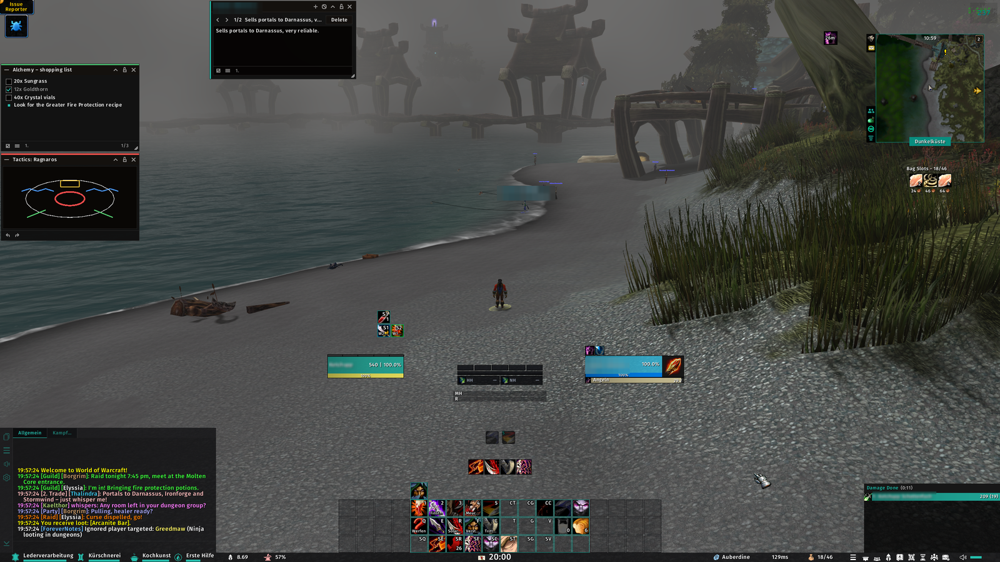
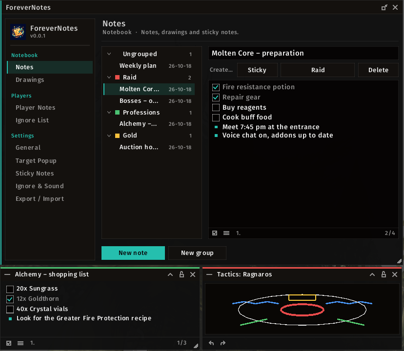
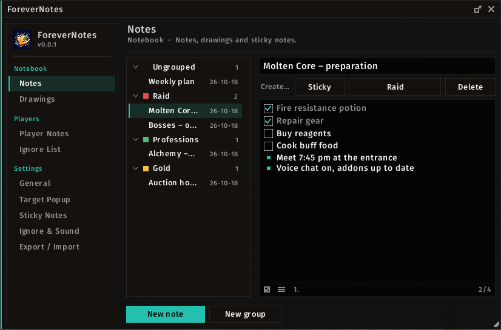
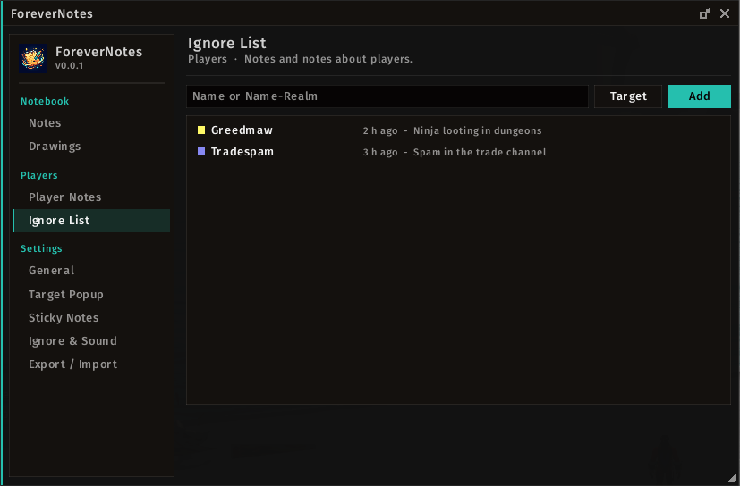
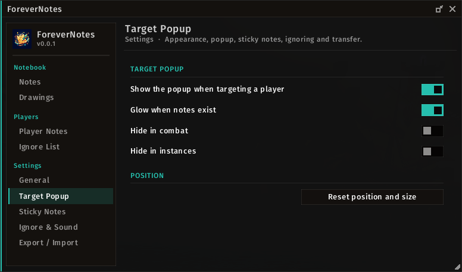
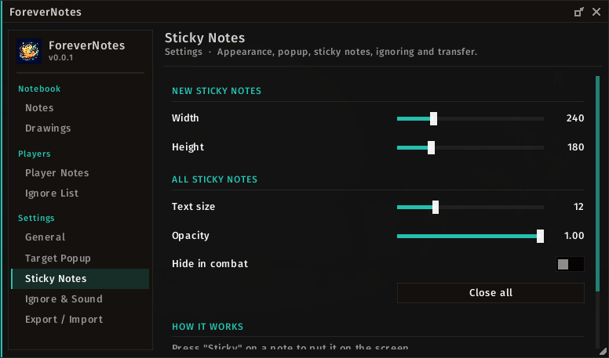
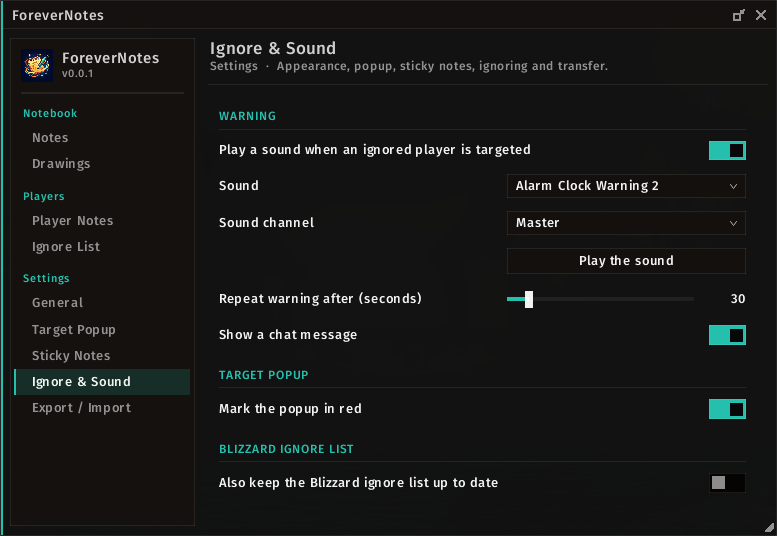
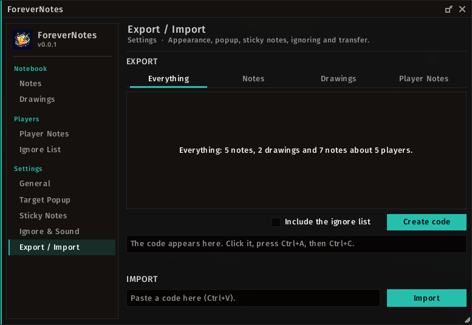

# ForeverNotes

A notes addon for **World of Warcraft: Forever**: a notebook with coloured groups, notes about players with a popup
when you target them, small drawings, your own ignore list with a warning sound, and sticky notes on the screen.
ForeverNotes runs on its own. If **EllesmereUI** is installed, it can also add its pages to the EllesmereUI options
window and take over its accent colour, font and language.

> **Unofficial.** This addon is not affiliated with or endorsed by EllesmereUI. EllesmereUI is optional and is
> installed separately. No code, graphics or fonts from EllesmereUI are included.

## Requirements

| Addon | Needed | Download |
|---|---|---|
| EllesmereUI | optional (integration into its options window, its accent colour, font and language) | [CurseForge](https://www.curseforge.com/wow/addons/ellesmereui) |

Nothing else. ForeverNotes uses no libraries.

## Features

- **Notebook:** notes in coloured groups; checklists with `[ ]` / `[x]` (click to tick), bullet lists with `-` or
  `*`, numbered lists with `1.` or `1)`.
- **Player notes:** several notes per player (`Name-Realm`). When you target a player, a small popup shows their
  notes; it can be collapsed to its title bar, and a pulsing strip tells you that notes exist.
- **Drawings:** pen, eraser, line, rectangle, ellipse, 12 colours plus any colour, five line widths, undo and redo.
- **Ignore list:** your own account-wide list with a reason. Targeting someone on it plays a sound of your choice,
  prints a chat line and marks the popup in red. Optionally keeps the game's ignore list in step.
- **Sticky notes:** any note or drawing as a small window on the screen; fold, lock, resize, dock sticky notes to
  each other.
- **Mini window:** notes, players, drawings and the ignore list in a compact window that also works in combat; one
  click away from the large window.
- **Export / import:** everything at once, or tick single notes, drawings or player notes (grouped by group or
  player), optionally with the ignore list, as a text code to share.
- **Looks:** seven themes (Standard, EllesmereUI when installed, Classic with the game's dialog frames, Parchment,
  Midnight, Frost, Light), a free accent colour (theme default, EllesmereUI accent, class colour or any colour) and a
  font of your choice: EllesmereUI's font, the game's fonts, or the bundled Barlow, Fira Sans, Inter and Source Code
  Pro (each regular, semibold and bold), with a preview of every font.
- English and German (automatic, or chosen in the settings).

## Usage

| Command | Effect |
|---|---|
| `/forevernotes` or `/fnotes` | open or close the ForeverNotes window (inside EllesmereUI when integrated) |
| `/forevernotes options` | the ForeverNotes window, also in combat |
| `/forevernotes eui` | the Notes section in the EllesmereUI options window (when integrated) |
| `/forevernotes mini` | toggle the mini window (also the button in the window's title bar) |
| `/forevernotes note` | new note for your target (works as a macro) |

The **minimap button** opens ForeverNotes with a left-click and the mini window with a right-click; drag it to move it
(it can be hidden under Settings › General or with `/forevernotes minimap`). The addon compartment entry works the same way.
The window has the same pages everywhere: **Notebook** (Notes, Drawings), **Players** (Player Notes,
Ignore List) and **Settings** (General, Target Popup, Sticky Notes, Ignore & Sound, Export / Import).

With EllesmereUI installed, *Settings › General › Integrate into EllesmereUI* adds the section **Notes** to its
options window (on by default; a change takes effect after `/reload`). The ForeverNotes window stays available with
`/forevernotes options`, and opens instead while you are in combat.

## Installation

Install from CurseForge, or copy the `ForeverNotes` folder into
`World of Warcraft/_classic_beta_/Interface/AddOns/` (the folder name must stay exactly `ForeverNotes`).

## Support

Bug reports and ideas: [GitHub Issues](https://github.com/HeartOfD2/ForeverNotes/issues). Please include the full Lua
error text and whether EllesmereUI is installed.

## Licence

MIT, see [LICENSE](LICENSE). The bundled fonts (Barlow, Fira Sans, Inter, Source Code Pro) are under the SIL Open
Font License 1.1; the license texts are in `Media/Fonts`. EllesmereUI belongs to its author.
